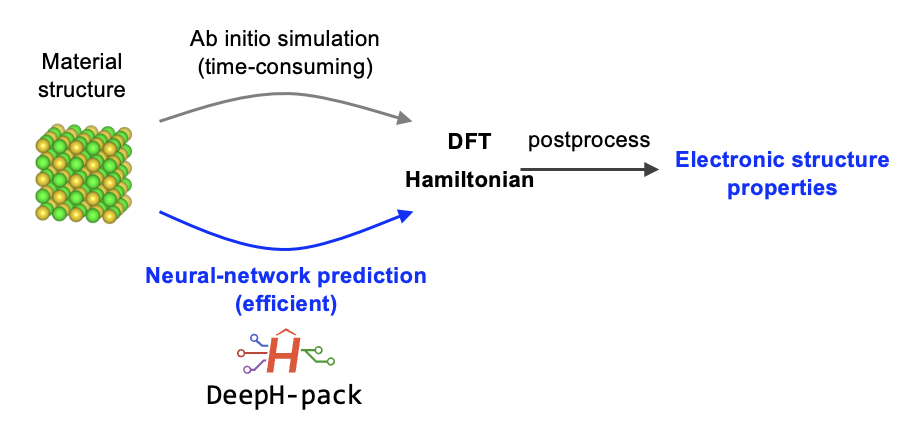

# 1. 理论背景

本部分对 DeepH 做一个粗线条的技术概览。

## 1.1. 深度学习哈密顿量方法（DeepH）

深度学习哈密顿量方法[于 2021 年首次提出](https://arxiv.org/abs/2104.03786)，已被广泛认为是
深度学习电子哈密顿量方向的代表性工作之一。尽管它最初是为固体体系的电子哈密顿量建模而设计的，
新版 DeepH-pack 在分子体系电子哈密顿量（Fock 矩阵）的建模上同样达到了很高精度。经过近五年的
发展，DeepH 在多个方向上都有深入进展，大致可以归为五类：

1. **最新的软件实现**

    - [Yang Li, Yanzhen Wang, Boheng Zhao, *et al*. DeepH-pack: A general-purpose neural network package for deep-learning electronic structure calculations. arXiv. (2026) (Submitted)](https://arxiv.org/abs/2601.02938)

2. **近期进展综述**

    - From DeepH and ML-QMC to fast, accurate materials computation [Nat. Comput. Sci. 5, 1133 (2025)](https://doi.org/10.1038/s43588-025-00932-4)

3. **模型架构的演进**

    - 原始框架 [Nat. Comput. Sci. 2, 367 (2022)](https://doi.org/10.1038/s43588-024-00723-3)
    - 引入等变神经网络 [Nat. Commun. 14, 2848 (2023)](https://doi.org/10.1038/s41467-023-38468-8)
    - 引入 eSCN 张量积 [arXiv:2401.17015 (2024)](https://arxiv.org/abs/2401.17015)
    - 借助物理启发的无监督学习 [Phys. Rev. Lett. 133, 076401 (2024)](https://doi.org/10.1103/PhysRevLett.133.076401)

4. **与第一性原理软件的兼容性提升**

    - 兼容平面波 DFT [Nat. Comput. Sci. 4, 752 (2024)](https://doi.org/10.1038/s43588-024-00701-9)
    - 扩展到杂化泛函 DFT [Nat. Commun. 15, 8815 (2024)](https://doi.org/10.1038/s41467-024-53028-4)

5. **应用场景的探索**

    - 用扩展版 DeepH 处理磁性体系 [Nat. Comput. Sci. 3, 321 (2023)](https://doi.org/10.1038/s43588-023-00424-3)
    - 研究密度泛函微扰理论 [Phys. Rev. Lett. 132, 096401 (2024)](https://doi.org/10.1103/PhysRevLett.132.096401)
    - 发展电子结构通用模型 [Sci. Bull. 69, 2514 (2024)](https://doi.org/10.1016/j.scib.2024.06.011)

一篇题为 **Deep-learning electronic structure calculations** 的综述即将发表，读者可从中获得
关于**深度学习电子结构**的全面概览。

需要强调的是，尽管经过了持续发展，DeepH 目前仍处于起步阶段，在应用层面尤其如此。我们正在探索
若干令人期待的应用场景，部分结果会在近期陆续公布。

## 1.2. 用 DeepH 做深度学习电子结构

下图是 DeepH 工作流程的粗略示意：

其核心思想是：我们不去直接建模带隙、电导率这类电子结构性质，而是用 DeepH 去建模 DFT 哈密顿量。
这样做会引入后处理的额外负担，但建模哈密顿量的好处是显而易见的，例如：

- DFT 哈密顿量包含了平均场层面的*全部*电子结构信息，因此原则上用单个模型就能导出所有平均场层面的电子结构性质。
- DFT 哈密顿量本身携带丰富的信息，正好契合深度学习对数据量的需求。
- 借助原子基组下的表示，DFT 哈密顿量与若干物理先验相容，从而可以启发 DeepH 的物理化设计。

谈到 DFT 哈密顿量的物理先验，首先要指出它可以表示在非正交的局域基组下。基函数可以写成：

$$\phi_{Iplm}(\textbf{r}-\textbf{R}_I)=R_{Ipl}(|\textbf{r}-\textbf{R}_I|)Y_{lm}(\textbf{r}-\textbf{R}_I)$$

这里以原子 $I$ 为中心的基函数除 $I$ 之外还有三个指标：多重度指标 $p$、角量子数 $l$ 和磁量子数
$m$。该基函数在 $\textbf{r}$ 处的取值由它相对原子核 $\textbf{R}_I$ 的位置决定，等于一个径向
函数与球谐函数的乘积。

下面引入简写 $\alpha\equiv(plm)$。局域基组下的 DFT 哈密顿量矩阵元可以形式化地写作：

$$H_{I\alpha J\beta}=\langle\phi_{I\alpha}|\hat{H}|\phi_{J\beta}\rangle$$

从这个定义出发，哈密顿量有两个显而易见的性质：

- 稀疏性：原子型基函数的径向部分会衰减，因此对相距很远的原子对 $I,J$，$H_{I\alpha J\beta}$ 趋于零。
- 等变性（协变性）：空间转动下，基函数的径向部分不变，球谐函数部分按一定规则变换。这就为理解 $H_{I\alpha J\beta}$ 在空间转动下的变换方式提供了数学基础，从而能够表达等变性（协变性）。

此外，由于哈密顿量是在局域基组下展开的，根据 Walter Kohn 的"近视原则"（nearsightedness
principle），某些矩阵元很大程度上由附近的原子结构决定，这就使得 DeepH 可以做 $O(N)$ 标度的预测。

上面我们简要讨论了原子基组下 DFT 哈密顿量的物理先验，但要在深度学习里真正实现并不简单，建议读者
参阅前述文献获取更详细的讨论。

总结一下，一次典型的 DeepH 研究，其流程大致是：

1. 生成包含电子哈密顿量的数据集（**本教程第 3 章**）
2. 训练 DeepH 模型（**第 4 章**）
3. 用 DeepH 做推理（**第 5 章**）
4. 后处理（具体任务而定，第 5 章会给出一个简单示例）
