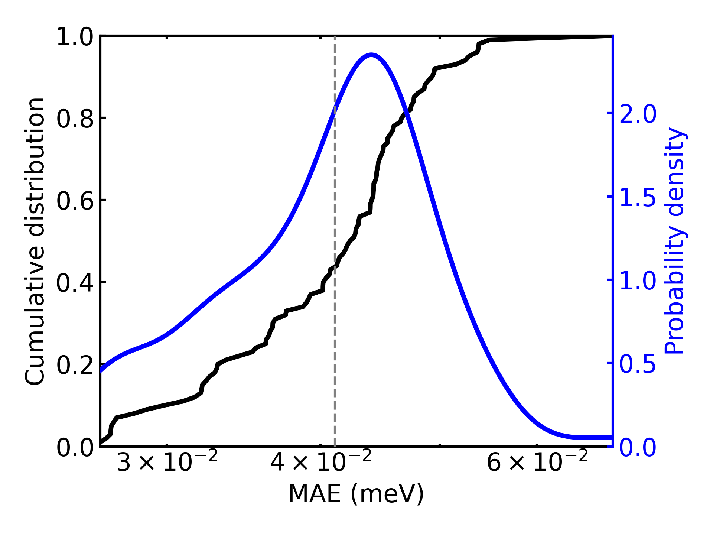
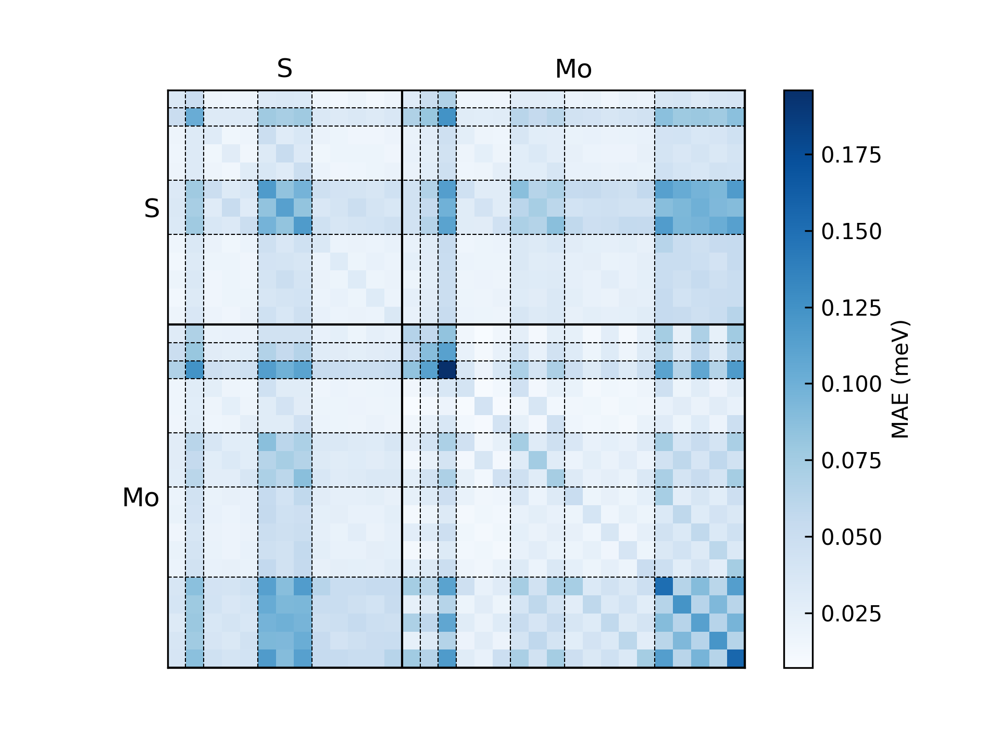
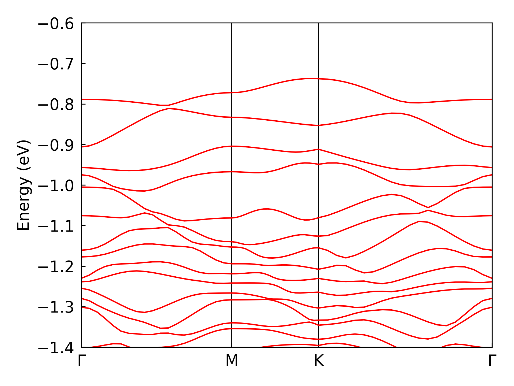
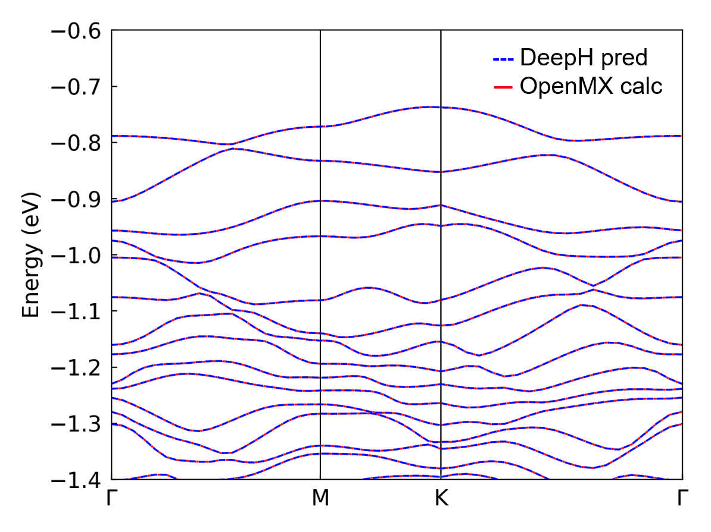

# 5. DeepH 推理

本部分给出 DeepH 推理的几个快速示例。对超大体系做电子结构推理，正是 DeepH-pack 的目的所在：在计算量
相对较小的体系上完成训练后，神经网络模型可以兼具高精度与高效率地推广到更大的体系。

**注意：** 本章的操作应在 `deeph` 环境下进行。


## 5.1. 准备推理所需的数据集
推理过程中哈密顿量矩阵是未知的，而重叠矩阵是必需输入。重叠矩阵的稀疏模式，对于推理时构建原子连接图
不可或缺。推理所需的数据如下所示，关键在于拿到重叠矩阵。

```bash
dft
  |- 0
     |- POSCAR
     |- info.json
     |- overlap.h5
  |- 1
  |- ...
```

**注意：**

- 尽管重叠矩阵的具体数值不影响神经网络模型的行为，但在对角化取能带等后处理中，其实际数值是必需的。
  换言之，在整个工作流中，重叠矩阵的计算*始终*不可缺少。
- 在多数基于局域轨道的*第一性原理*程序中，重叠矩阵可以通过一次非自洽计算高效得到，无需求解昂贵的 SCF
  循环，也不必对角化。因此重叠矩阵的生成不会影响 DeepH-pack 推理流程整体的 $O(N)$ 时间开销。

### 5.1.1 OpenMX
OpenMX 没有内置只算重叠矩阵的选项，因此需要修改 OpenMX 源码。详见
[overlap-only-OpenMX](https://github.com/mzjb/overlap-only-OpenMX) 仓库。这个修改版 OpenMX 在输出
重叠矩阵后即退出。输出的重叠矩阵（DeepH 的旧数据格式）随后可以通过
[DeepH-dock](3.Interface.md) 转换为新数据格式。

### 5.1.2 ABACUS
要用 ABACUS 做只算重叠矩阵的计算，在 `INPUT` 文件中把 `calculation scf` 改为 `calculation get_S` 即可，
无需改动源码。程序在输出 `SR.csr` 文件后退出，该文件可以通过 [DeepH-dock](3.Interface.md) 转换为新的
数据格式。

### 5.1.3 FHI-aims
在 FHI-aims 中设置 `sc_iter_limit = 0`，即可执行一次只提取重叠矩阵的非自洽计算。与此同时，DeepH 推理
本身只需 `POSCAR` 和 `info.json` 就能预测哈密顿量——DFT 层面的计算始终只是可选的，用于核验结果。

## 5.2. 用 DeepH 做推理
推理过程可以在 CPU 或 GPU 平台上进行。GPU 平台虽然快得多，但显存（例如 NVIDIA 4090 的 24GB）不足以
支撑大体系（例如单胞含 10000 个原子）。因此推理更常用 CPU 平台。

推理设置包含三个必要组成部分：

- TOML 配置文件
- `inputs/` 目录（包含 POSCAR、info.json 和 overlap.h5）
- `model/` 目录（包含优化好的模型参数）

### 5.2.1 FHI-aims $\text{H}_2\text{O}$
对于[上一章](4.Training.md)刚训练过的 $\text{H}_2\text{O}$ 体系，可以用下面的配置文件做推理。
`./inputs/dft` 目录已经链接到训练所用的数据集。


```toml
# ---------------------------------- SYSTEM ----------------------------------
[system]
note = "Enjoy DeepH-pack! ;-)"
device = "gpu*1"
float_type = "fp32"
random_seed = 137
log_level = "info"
jax_memory_preallocate = true


# ----------------------------------- DATA ------------------------------------
[data]
inputs_dir = "./inputs"
outputs_dir = "./outputs"

[data.dft]
data_dir_depth = 0
validation_check = false

[data.graph]
dataset_name = "H2O_5K_FHI-aims"
graph_type = "S"
storage_type = "memory"
parallel_num = -1
only_save_graph = false


# ----------------------------- MODEL -----------------------------------------
[model]
model_dir = "../../4.Training/H2O_5K_FHI-aims/outputs/2025-10-14_10-34-43/model"
load_model_type = "best"
load_model_epoch = -1


# ------------------------------ PROCESS --------------------------------------
[process.infer]
output_type = "h5"
output_into = "to_output"
target_symmetrize = true
multi_way_jit_num = 1

[process.infer.dataloader]
batch_size = 1000
```

**注意：**

- `model.model_dir` 是训练时保存模型的目录，相对路径和绝对路径都支持。该目录应以 "model" 结尾。
  `model.load_model_type` 用于选择 model_dir 下的 "latest.pytree" 还是 "best.pytree"。
- `process.infer.output_into` 控制输出哈密顿量的位置："to_output" 表示 `data.outputs_dir.dft`，
  "to_input" 表示 `data.inputs_dir.dft`。

在配有 `slurm` 之类作业管理系统的超算平台上执行推理时，建议写一个脚本再提交作业。

```bash
#!/bin/bash
#
#SBATCH --job-name=H2O-infer
#SBATCH --gpus=1
#SBATCH -p gpu

module load cuda/12.9
source ~/.uvenv/deeph/bin/activate

deeph-infer infer.toml
```

配置文件和提交脚本都已经放在 "H2O_5K_FHI-aims" 目录下，一条命令即可执行推理：

```bash
sbatch submit.sh
```

推理结果随后会以 `hamiltonian_pred.h5` 的形式写入 outputs（或 inputs）目录。

```bash
infer-outputs/<timestamp>
  |- deepx.log
  |- dft
    |- 0
       |- hamiltonian_pred.h5
    |- 1
       |- hamiltonian_pred.h5
    |- ...
```

前面给出的水分子训练与推理示例，主要是一个简化的演示，用来展示 DeepH 在实际科研应用中的潜力。

### 5.2.2 OpenMX $\text{MoS}_2$
为了呈现更贴近真实研究的完整实现，我们给出一个完整的 $\text{MoS}_2$ 数据集，它最初由
[DeepH-E3](https://www.nature.com/articles/s41467-023-38468-8) 提供。由于训练该模型的计算量很大
（需要 1–2 天的 GPU 训练），本教程无法实际演示完整的训练过程，但我们提供了训练充分、已收敛的模型参数，
供社区做实验和推理使用。

本例使用 `eagle` 网络。凭借进阶的架构，该模型的哈密顿量预测精度相当可观，平均绝对误差（MAE）为
41 $\mu\text{eV}$。

$\text{MoS}_2$ 模型推理的配置文件如下。

``` toml
# ---------------------------------- SYSTEM ----------------------------------
[system]
note = "Enjoy DeepH-pack! ;-)"
device = "gpu*1"
float_type = "fp32"
random_seed = 137
log_level = "info"
jax_memory_preallocate = true


# ----------------------------------- DATA ------------------------------------
[data]
inputs_dir = "./inputs"
outputs_dir = "./outputs"

[data.dft]
data_dir_depth = 0
validation_check = false

[data.graph]
dataset_name = "MoS2_500_OpenMX"
graph_type = "S"
storage_type = "memory"
parallel_num = -1
only_save_graph = false


# ----------------------------- MODEL -----------------------------------------
[model]
model_dir = "./outputs_previous_train/2025-11-08_07-38-37/model"
load_model_type = "best"
load_model_epoch = -1


# ------------------------------ PROCESS --------------------------------------
[process.infer]
output_type = "h5"
output_into = "to_output"
target_symmetrize = true
multi_way_jit_num = 1

[process.infer.dataloader]
batch_size = 30
```

**注意：** 推理过程的内存占用远小于训练过程。本教程中的推理都是在与训练结构同等大小的结构上进行的，
因此 `process.infer.dataloader.batch_size` 可以比训练时的批大小大得多。

### 5.2.3 ABACUS 石墨烯
为展示 DeepH-pack 与各类第一性原理程序协同工作的能力，我们给出一个由 ABACUS 计算得到的单层石墨烯数据集。
本例使用 `sparrow` 网络——一种用于简单体系高效建模的轻量架构，仅训练 9 小时即达到 82 $\mu\text{eV}$
的 MAE 精度。

其推理配置与上面的 $\text{MoS}_2$ 几乎相同，只需修改图名称和路径；模型设置会自动从 `model.model_dir`
读入，对用户相当友好。

---

这些示例展示了 DeepH 把海量量子材料数据集转化为紧凑、高精度计算模型的能力。在各类 DFT 软件生成的数据集上，
`sparrow` 与 `eagle` 网络都表现良好：`sparrow` 以较低的计算开销取得高精度，`eagle` 则在此基础上进一步
提升精度（比 `sparrow` 提高 50% 到 100%），代价是效率上有可接受的损失（大约比 `sparrow` 慢 50%）。
用户可以根据自己的具体需求选择最合适的网络配置。


## 5.3. 误差分析
为确认模型的有效性，需要把推理结果 `hamiltonian_pred.h5` 与基准数据 `hamiltonian.h5` 做比较。误差的
提取与可视化可以用 DeepH-dock 中的 `dock.error.ExposeErrorDist` 命令完成。它给出的是详细的误差分布，
而不只是一个损失值。

```bash
cd ./outputs/<timestamp>
dock.error.ExposeErrorDist dft -b ../../inputs/dft -k structure -p 5
```
这会生成一张图 `error_structure_distribution.png`，展示每个结构的误差分布。$\text{MoS}_2$ 示例的结果如下：



```bash
cd ./outputs/<timestamp>
dock.error.ExposeErrorDist dft -b ../../inputs/dft -k orbital -p 5
```
这会生成一张图 `error_orbital_resolute_distribution.png`，展示按轨道对分解的误差。$\text{MoS}_2$
示例的结果如下：



通过 `-k` 选项可以选择多种误差模式：

- "orbital"：每个轨道对的误差。
- "element-pair"：每个元素对的误差。
- "element(-logfile)"：每个元素的误差。
- "entries"：矩阵元的误差，并给出散点图。
- "structure(-logfile)"：每个结构的误差分布。

**注意：**

- 通过 `--cache_res` 选项可以导出原始数据（而不只是图）。
- 用 `--data_split_json` 及相关选项可以只选取子集做误差统计。


## 5.4. 确定并更新费米能

通过推理过程得到预测的哈密顿量（默认名为 `hamiltonian_pred.h5`）之后，可以借助 `DeepH-dock` 对其
对角化并绘制相应的能带结构，便于后续分析与比较。

在 DeepH 中，只相差一个能量平移规范变换（$H' = H - \mu S$）的哈密顿量被视为等价。DeepH 的预测并不保证
规范不变性，尤其当训练数据集中含有规范选取差异很大的结构时。在那种情况下，依据电子占据数重新确定费米能
就成为必要步骤。`deeph-dock` 为此提供了专门的工具。用户需要先准备以下四个前置文件：
```bash
cd MoS2_500_OpenMX/band/502
ln -s ../../outputs/<timestamp>/dft/502/hamiltonian_pred.h5 ./hamiltonian.h5
```

其中 `<timestamp>` 是你推理时的时间戳。当前目录看起来应当如下：
```bash
band/502/
    |- POSCAR
    |- info.json
    |- overlap.h5
    |- hamiltonian.h5 -> ../../outputs/<timestamp>/dft/502/hamiltonian_pred.h5
```

随后需要在 `info.json` 的 "occupation" 键下给出总价电子数。这个数字通常包含在程序的输出文件里，否则
可以借助赝势信息自行计算。以 $\text{Mo}_{25}\text{S}_{50}$ 为例：对采用 PBE19 赝势的 OpenMX，
occupation 是价电子数之和，即 $14\times 25 + 6\times 50=650$；而对全电子程序 FHI-aims，occupation 是
原子序数之和，即 $42\times 25 + 16\times 50 = 1,850$。

```json
{
  "occupation": 650, # OpenMX with PBE19 pesudopotential
  "atoms_quantity": 75,
  "orbits_quantity": 1125,
  "orthogonal_basis": false,
  "spinful": false,
  "fermi_energy_eV": 0.0,
  "elements_orbital_map": {"Mo": [0, 0, 0, 1, 1, 2, 2], "S": [0, 0, 1, 1, 2]}
}
```

**注意：** 这里的 occupation 始终包含自旋简并，当 `spinful` 为 false 时程序会自动处理自旋简并。对上面
这个无自旋的情形，它将给出 $650\div 2 = 325$ 个占据能带。

随后，只需在数据目录中执行以下命令来计算费米能。

```bash
cd band/502
dock.dos.FindFermi -p 5 .
```

计算得到的费米能会存入 `fermi_energy.json`。

```json
{"fermi_energy_eV": -4.966581910156199}
```
用这个值替换 `info.json` 中的 "fermi_energy_eV"，就可以运行能带结构计算了。

**注意：** 用户可能会注意到，本实现有意不提供自动更新费米能级的功能。这一设计源于两个核心原则：

- 保持原始数据的完整性在神经网络训练中至关重要，因为改动源数据集本身带有风险——因此我们刻意设置了防止
  误操作的屏障。
- 我们鼓励用户用 Python 脚本实现简单的功能，就像写 Bash 脚本做数据提取一样。DeepH-pack 更倾向于提供
  一个灵活的计算框架，而不是一个大包大揽的黑箱程序。


## 5.5. 绘制能带

要得到能带结构，在能带计算时还需要一个额外的文件 `K_PATH`。该文件指定能带结构所用的高对称路径，
可以手工书写。对层状 $\text{MoS}_2$，路径可以是：

```bash
20  0.000000 0.000000 0.000000  0.000000 0.500000 0.000000  Gamma M
20  0.000000 0.500000 0.000000  0.333333 0.333333 0.000000  M K
20  0.333333 0.333333 0.000000  0.000000 0.000000 0.000000  K Gamma  
```

每一行包含：k 点数目、第一和第二个高对称点的分数坐标，以及它们的标签。

```bash
band/502/
    |- POSCAR
    |- info.json
    |- overlap.h5
    |- hamiltonian.h5 -> ../../outputs/<timestamp>/dft/502/hamiltonian_pred.h5
    |- K_PATH
```

最后，可以用下面的命令得到能带结构图：

``` bash
cd band/502
dock.band.CalcData -p 5 .
```

其中 `-p 5` 表示在 k 点上做 5 核并行，可根据可用的计算资源调整。

得到能带文件 `band.h5` 后，可以用下面的命令绘制能带结构：

``` bash
dock.band.PlotPNG --min <Emin> --max <Emax> .
```

其中 `Emin` 和 `Emax` 设定能带结构图的能量范围。得到的能带结构如下图所示：




### 5.5.1 与基准数据对比
如果能拿到第一性原理软件计算的数据，就可以把第一性原理计算的能带与 DeepH-pack 推理的能带放在一起比较。
下图给出某个 $\text{MoS}_2$ 结构的对比：




## 5.6. DeepH 加速的自洽计算

如上所示，DeepH 预测的哈密顿量明显优于*第一性原理*软件内部的初始猜测哈密顿量。把 DeepH 预测的哈密顿量
作为重启猜测回填给软件继续计算，可以大幅减少达到收敛所需的 SCF 迭代步数。相应的数据流程正在开发中，
很快会在 `deeph-dock` 工具包中发布。
