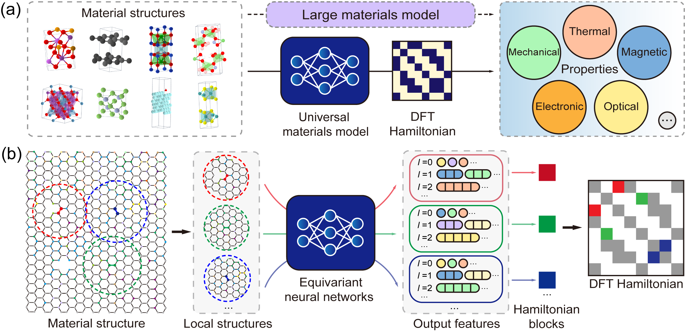

# 6. 通用材料模型之旅

最后，我们来到 DeepH 最令人兴奋的部分：通用材料模型（Universal Materials Model, UMM）。本节用
$\text{MoS}_{2}$ 数据集做一个实例演示，展示该模型的能力。


## 6.1 什么是 DeepH-UMM？
DeepH-UMM（Deep Learning DFT Hamiltonian Universal Material Model）是计算材料科学领域的一项重要进展。
它是一个基于深度学习的通用模型，用于预测各种材料的电子结构。关键在于，它的适用范围覆盖了元素周期表中
任意元素组成的材料。

DeepH-UMM 的核心优势来自它的训练过程。它利用了一个覆盖大量已知材料的广泛而多样的数据集。这样充分的训练
使模型能够学到深层的物理规律——材料的原子组分与结构如何决定其电子性质。掌握了这些基本原理之后，
DeepH-UMM 展现出极强的泛化能力：它可以准确预测此前从未见过的新材料的电子结构，从而在实际上省去了为每种
新化合物单独做第一性原理计算的需要。

本质上，DeepH-UMM 是一个强有力的计算工具，它弥合了材料组分与电子行为之间的鸿沟，加速了新功能材料的发现
与理解。


*DeepH-UMM 早期的概念验证版本。*

*Yuxiang Wang\*, Yang Li\*, Zechen Tang\*, et.al. Science Bulletin 69, 2514 (2024)*


## 6.2 用通用材料模型做一次性推理
DeepH-UMM 可以直接预测目标材料的性质，无需针对特定数据集重新训练。它的使用流程与传统专用模型完全相同。
正如徐勇教授在报告中所强调的：
> "我们在 200 万种材料上训练了一个通用模型，达到了亚 meV 量级的精度。该模型在元素周期表前六行的元素上
> 都表现出色，相关论文正在准备中。"

该模型是在一个庞大的数据集上训练的，其中包含数万亿个哈密顿量矩阵元，图结构数据文件的训练集规模达到数百
TB。

本教程提供的是一个*受限版 UMM*，它在 2 万种材料上训练，覆盖 63 种常见元素（周期表第 1 至 6 行）。这个
受限版 UMM 同样对所覆盖元素范围内的任何材料展现出稳健的预测能力，并经过严格验证达到了*第一性原理*精度
（哈密顿量矩阵元的平均绝对误差约 1.3 meV）。

执行下面的命令即可启动大模型推理。数据准备与模型加载的流程与[第 5 章](./5.Inference.md)所述完全一致。
```bash
cd ~/workshop/6.UMM_Odyssey/1.Do_Inference
sbatch submit.sh
```

本演示中，我们对 100 个 $\text{MoS}_2$ 晶体结构做推理。对应的 TOML 推理配置如下：
```toml
# ---------------------------------- SYSTEM ----------------------------------
[system]
note = "Adventure of DeepH-UMM :/"
device = "gpu*1"
float_type = "fp32"
random_seed = 137
log_level = "info"
jax_memory_preallocate = true

# ----------------------------------- DATA ------------------------------------
[data]
inputs_dir = "./inputs"
outputs_dir = "./outputs"

[data.dft]
data_dir_depth = 0
validation_check = false

[data.graph]
dataset_name = "MoS2_100_OpenMX"
graph_type = "S"
storage_type = "memory"
parallel_num = -1
only_save_graph = false


# ----------------------------- MODEL -----------------------------------------
[model]
model_dir = "../_.DeepH-UMM.D20k-P48M/model"
load_model_type = "best"
load_model_epoch = -1


# ------------------------------ PROCESS --------------------------------------
[process.infer]
output_type = "h5"
output_into = "to_output"
target_symmetrize = true
multi_way_jit_num = 1

[process.infer.dataloader]
batch_size = 10
```

推理结果保存在 `outputs/<timestamp>` 目录下。可以用下面的命令可视化预测误差的分布：
```bash
cd ~/workshop/6.UMM_Odyssey/1.Do_Inference/outputs/<timestamp>
dock.error.ExposeErrorDist dft -b ../../inputs/dft --task structure -p 2
```

**注意：** 在超算平台上，**强烈不建议**直接在登录节点上执行任何重计算任务。有经验的用户应当通过提交作业
脚本，把命令派发到计算节点上执行。

UMM 的预测结果与基准数据之间的哈密顿量 MAE 为 $1.44\text{meV}$，接近其在原始测试集上的损失
（$1.29\text{meV}$）。通用材料模型可在广泛的材料上给出可靠的一次性预测，且无需训练过程，对用户来说很方便。


## 6.3. 微调通用材料模型
回顾[第 4 章](./4.Training.md)与[第 5 章](./5.Inference.md)建立的训练与推理流程，你可能会注意到，
DeepH-UMM 目前在特定材料体系上的精度还有提升空间。在专用数据集上训练时，DeepH 模型通常经过数天训练
就能把哈密顿量预测精度做到几百 μeV 以内；而本教程中的通用材料模型（UMM）精度维持在 1.0 meV 左右。

这一性能差距在科学上是可解释的：

- UMM 处理的空间结构要复杂得多。
- 2 万种材料的训练集仍不足以刻画复杂的物理相互作用。

值得注意的是，通过微调技术，我们可以提升这个相对粗糙的模型在目标数据集上的精度。与从零训练的专用模型相比，
微调能带来：

- ✓ 更快的收敛（1–2 个 epoch 就能显著优于一次性预测）
- ✓ 数十个 epoch 即可达到有竞争力的精度（完整训练则需要数百到数千个 epoch）
- ✓ 计算成本上的资源效率

DeepH-pack Light 版本目前支持全参数微调（迁移学习模式），但未实现 LoRA 之类的参数高效方法。要启动微调，
执行：

```bash
cd ~/workshop/6.UMM_Odyssey/2.Lets_Finetune_It
sbatch submit.sh
```

用 TOML 格式写成的微调配置如下。我们借助 resume 模块来支持微调任务。

把 `process.train.continued.previous_output_dir` 设为你自己路径下的 UMM 目录。可以用下面的方式取得该路径：
```bash
cd ~/workshop/6.UMM_Odyssey/_.DeepH-UMM.D20k-P48M
pwd
> /data/run01/user/share/workshop/6.UMM_Odyssey/_.DeepH-UMM.D20k-P48M
# Set process.train.continued.previous_output_dir to ^^^^^^^^^
```

```toml
# ---------------------------------- SYSTEM ----------------------------------
[system]
note = ""
device = "gpu*1"
float_type = "fp32"
random_seed = 137
log_level = "info"
jax_memory_preallocate = true
show_train_process_bar = false

# ----------------------------------- DATA ------------------------------------
[data]
inputs_dir = "./inputs"
outputs_dir = "./outputs"

[data.dft]
data_dir_depth = 0
validation_check = false

[data.graph]
dataset_name = "MoTe2_100_OpenMX"
graph_type = "HS"
storage_type = "memory"
common_orbital_types = ""
parallel_num = -1
only_save_graph = false

[data.model_save]
best = true
latest = true
latest_interval = 5
latest_num = 1

# ----------------------------- MODEL -----------------------------------------
[model]
net_type = "eagle"
target_type = "H"
loss_type = "mae"

[model.advanced]
gaussian_basis_rmax = 7.5
net_irreps = "96x0e+96x1e+80x2e+40x3e+20x4e+8x5e"
num_blocks = 6
num_heads = 2
enable_bs3b_layer = true
bs3b_orbital_types = "s15p12d7"
consider_parity = false
standardize_gauge = true

# ------------------------------ PROCESS --------------------------------------
[process.train]
max_epoch = 1000

multi_way_jit_num = 1
ahead_of_time_compile = true
do_remat = false

[process.train.dataloader]
batch_size = 1

train_size = 80
validate_size = 10
test_size = 10
dateset_split_json = ""
only_use_train_loss = false

[process.train.drop]
dropout_rate = 0.0
stochastic_depth = 0.00
proj_rate = 0.0

[process.train.optimizer]
type = "adamw"
init_learning_rate = 3E-4
clip_norm_factor = -1.0
betas = [0.9, 0.999]
weight = 0.001
eps = 1E-8

[process.train.scheduler]
min_learning_rate_scale = 1.01E-3
type = "warmup_cosine_decay"
init_scale = 0.1
warmup_steps = 1200
decay_steps = 24000
end_scale = 1E-3

[process.train.continued]
enable = true
new_training_data = true
new_optimizer = true
previous_output_dir = "\\Add DeepH-UMM Training Outputs Path Here//"
load_model_type = "best"
load_model_epoch = -1
```

日志文件如下所示。
```text
[ 11.20-22:00:45 ]
[ 11.20-22:00:45 ]            Welcome to DeepH-pack (deepx)!
[ 11.20-22:00:45 ]                  Version 1.0.6
[ 11.20-22:00:45 ]
[ 11.20-22:00:45 ] ...................................................
[ 11.20-22:00:45 ] ........_____....................._...._.[PACK]....
[ 11.20-22:00:45 ] .......|  __ \...................| |..| |..........
[ 11.20-22:00:45 ] .......| |  | | ___  ___ ._ _ ...| |..| |..........
[ 11.20-22:00:45 ] .......| |  | |/ _ \/ _ \| '_ \ .|X'><'X|..........
[ 11.20-22:00:45 ] .......| |__| |. __/. __/| |_) |.| |..| |..........
[ 11.20-22:00:45 ] .......|_____/ \___|\___|| .__/ .|_|..|_|..........
[ 11.20-22:00:45 ] .........................| |.......................
[ 11.20-22:00:45 ] .........................|_|.......................
[ 11.20-22:00:45 ] ...................................................
[ 11.20-22:00:45 ]
[ 11.20-22:00:45 ]             Copyright CMT@Phys.Tsinghua
[ 11.20-22:00:45 ]                  Powered by JAX
[ 11.20-22:00:45 ]
[ 11.20-22:00:45 ]
[ 11.20-22:00:45 ] [system] Under the machine `user@gpu-node`, with `x86_64 (64 cores)` CPU, and `1007GB` RAM.
[ 11.20-22:00:46 ] [system] Use the GPU device(s) `[0]` of totally `1` device(s). Succeeded test on the head device `cuda:0`!
[ 11.20-22:00:46 ] [system] Totally use `64` CPU cores.
[ 11.20-22:00:46 ] [system] The calculation will be sharding across `Mesh('data': 1, axis_types=(Auto,))`.
[ 11.20-22:00:46 ] [system] Set random stream with seed `137`, type `key<fry>`.
[ 11.20-22:00:46 ] [system] Using the float type `fp32`. The testing results on JAX and PyTorch are `jnp.float32` and `torch.float32`
[ 11.20-22:00:56 ] [graph] Building the graph with type: `train-HS`.
[ 11.20-22:00:56 ] [rawdata] Read in features from json: `~/workshop/6.UMM_Odyssey/2.Lets_Finetune_It/inputs/dft/features.json`.
[ 11.20-22:00:56 ] [graph] Establishing the graph from the DFT raw data: `~/workshop/6.UMM_Odyssey/2.Lets_Finetune_It/inputs/dft`.
[ 11.20-22:00:56 ] [graph] Start processing `100` structures with `32` processes.
[ 11.20-22:01:16 ] [graph] Finish processing `100` structures.
[ 11.20-22:01:23 ] [graph] Saved the graph set in memory to `~/workshop/6.UMM_Odyssey/2.Lets_Finetune_It/inputs/graph/MoTe2_100_Op
[ 11.20-22:01:23 ] [graph] Using the common orbital types: `[0, 0, 0, 1, 1, 2, 2]`
[ 11.20-22:01:23 ] [graph] Split the graph set with batch size: `1`
[ 11.20-22:01:24 ] [dataloader] Train size: `80`. Val size: `10`. Test size: `10`.
[ 11.20-22:01:24 ] [dataloader] Data sharding way: `1`. Batch size: `1`. Number of nodes each batch: `[77]`, `[77]`, `[77]`. Number of edges each batch:
[ 11.20-22:01:24 ] [dataloader] The training dataset encompasses `335046` edges, aggregating a total of `74783913` data entries.
[ 11.20-22:01:24 ] [model] Building the model `eagle-H` with loss `mae`.
[ 11.20-22:01:25 ] [model] Initializing the net parameters with dummy data...
[ 11.20-22:02:38 ] [model] The parameters size is `48079884`.
[ 11.20-22:02:39 ] [optimizer] Using the optimizer `AdamW` with: betas `[0.9, 0.999]`, eps `1e-08`, weight decay strength `0.001`, and initial learning rate `0.0003`.
[ 11.20-22:02:39 ] [optimizer] The global CLIP norm algo factor is NOT USED.
[ 11.20-22:02:39 ] [optimizer] Using the scheduler `WarmupCosineDecay` with: init scale `0.1`, warmup steps `1200`, decay steps `24000`, end scale `0.001`.
[ 11.20-22:02:43 ] [model] We will save the model into `~/workshop/6.UMM_Odyssey/2.Lets_Finetune_It/outputs/2025-11-20_22-00-38/model`. The best model will be saved. The latest model (keep `1` each `5` epoch) will be saved.
[ 11.20-22:02:43 ] [train] JAX networks: Parallel threads AOT-compiling `1` frameworks for training and `1` for validation.
[ 11.20-22:04:32 ] [train] Compile networks done!
[ 11.20-22:04:32 ] [model] We are loading the `best` model inside `~/workshop/6.UMM_Odyssey/_.DeepH-UMM.D20k-P48M`. We are using the new training dataset, and applying new optimizer.
[ 11.20-22:04:33 ] [train] Starting the training process ...
[ 11.20-22:05:59 ] [train] Epoch 1 | Time 72.46 s | Train-Loss 7.733642e-04 | Val-Loss 5.755628e-04 | Scale 0.1600000262260437
[ 11.20-22:06:40 ] [train] Epoch 2 | Time 33.94 s | Train-Loss 5.064172e-04 | Val-Loss 4.295226e-04 | Scale 0.2200000286102295
[ 11.20-22:07:20 ] [train] Epoch 3 | Time 33.21 s | Train-Loss 4.242459e-04 | Val-Loss 3.906064e-04 | Scale 0.2800000309944153
[ 11.20-22:07:59 ] [train] Epoch 4 | Time 34.01 s | Train-Loss 4.072940e-04 | Val-Loss 3.449457e-04 | Scale 0.3399999737739563
[ 11.20-22:08:49 ] [train] Epoch 5 | Time 34.00 s | Train-Loss 4.048322e-04 | Val-Loss 3.347684e-04 | Scale 0.3999999761581421
[ 11.20-22:09:29 ] [train] Epoch 6 | Time 33.97 s | Train-Loss 4.242831e-04 | Val-Loss 3.849993e-04 | Scale 0.4599999785423279
[ 11.20-22:10:08 ] [train] Epoch 7 | Time 34.00 s | Train-Loss 5.183004e-04 | Val-Loss 5.113371e-04 | Scale 0.5199999809265137
[ 11.20-22:10:48 ] [train] Epoch 8 | Time 34.07 s | Train-Loss 5.049233e-04 | Val-Loss 5.360487e-04 | Scale 0.5799999833106995
[ 11.20-22:11:26 ] [train] Epoch 9 | Time 33.30 s | Train-Loss 4.957246e-04 | Val-Loss 5.422708e-04 | Scale 0.6399999856948853
```
