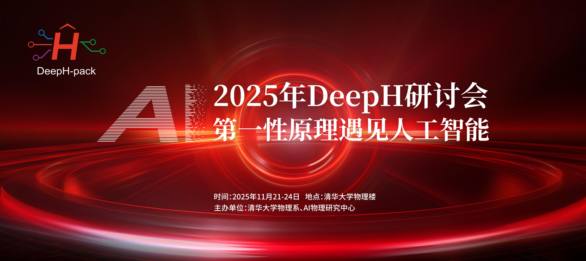

# DeepH-pack Workshop 2025 中文教程

> 作者：Yang Li（DeepH-pack 训练部分）、Bohen Zhao（DeepH-pack 推理部分）、
> Honggeng Tao（DeepH-dock 部分）、Zechen Tang（接口部分）、Yong Xu（课题组负责人）

本教程面向 [**DeepH-pack**](https://www.nature.com/articles/s43588-022-00265-6) 的实操，
涵盖环境安装、数据集准备、模型训练、推理，以及通用材料模型（Universal Materials
Model）的探索。

## 翻译进度

中文版正在翻译中。目前已完成第 1–3 章（理论背景、安装、数据接口），其余章节会陆续补上，
做完一章就会出现在左侧目录里。

英文原文始终是完整的，可在页面**右下角**的 Read the Docs 悬浮按钮里切换语言：
展开后 "Translations" 一栏会列出 English 与简体中文。

## 教程结构

- `1.Theoretical_backgrounds.md`：理论背景的简要技术导引。
- `2.Installation.md`：安装 DeepH-pack 及相关前后处理工具（多数集成在 DeepH-dock 中）。
- `3.Interface.md`：生成 DeepH 格式的哈密顿量与结构文件，供后续训练使用。
- `4.Training.md`：如何完成 DeepH-pack 训练。
- `5.Inference.md`：DeepH 推理的完整示例。
- `6.UMM_odyssey`：使用预训练的通用材料模型。

## 关于 DeepH

DeepH（Deep-learning electronic Hamiltonian methods）是清华大学物理系徐勇教授与段文晖教授
课题组发展的深度学习框架，用于对 DFT 电子哈密顿量做神经网络建模。与拟合势能面的方法不同，
它学习的是电子哈密顿量本身——由哈密顿量可以直接得到能带、态密度等一系列平均场层面的电子性质，
因此可以看作是具有第一性原理精度的经验紧束缚模型的深度学习对应物。

尽管在接口与教程上投入了大量精力，该软件包在功能上仍处于早期阶段。我们欢迎关于其发展与改进的
任何讨论、反馈与建议。
